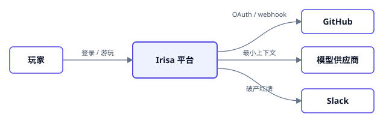
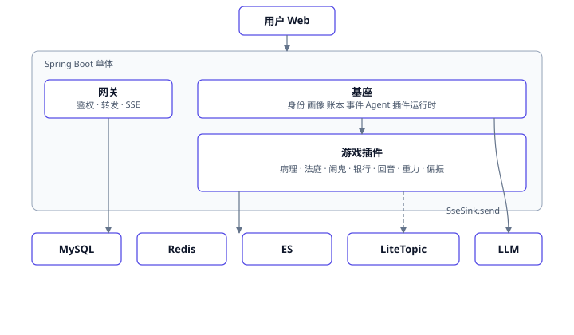
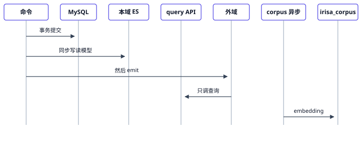
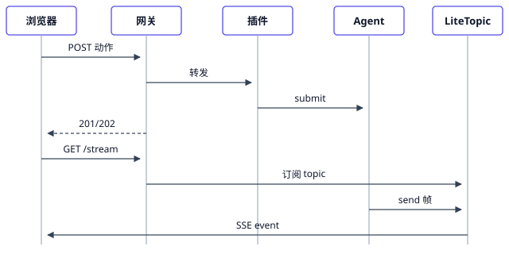
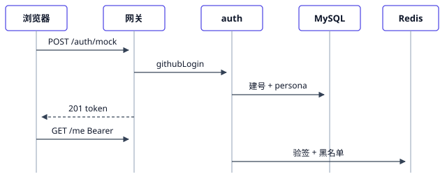

# Irisa 基座与首发游戏技术方案

## 1. 文档说明

本文是 Irisa 的实施方案。不熟悉项目的研发应能从系统边界、运行容器、模块职责、核心流程、数据模型、接口契约和验收标准中，理解系统要做什么以及如何实现。

组织方式：

1. System Context：系统作为黑盒与外部世界的关系。
2. Container：由哪些运行容器组成，容器之间如何交互。
3. Module：后端模块的职责、端口、内部流程和依赖方向。
4. Data：持久化对象、DDL、领域事件和 SSE 帧通道。
5. Delivery：对外接口、SSE、错误契约。
6. Operations：安全、恢复、观测、测试和发布顺序。

玩法语义见 `docs/games/`。HTTP/SSE 字段以 `docs/contracts/` 为准。栈决策见 `docs/adr/`。

### 1.1 方案范围

- 一个可容器化的 Spring Boot 模块化单体（Spring Modulith）。
- 网关持有 HTTP 与 SSE，经游戏前门调 `game.*` 模块（P0 进程内，拆服务可换 HTTP）；身份子域持有玩家与画像与 JWT；基座实现技术端口，不扫游戏、不持身份。
- 七款反思游戏作为 Modulith 模块挂载，跨游戏只走已登记领域事件。无 plugin-api / host-sdk jar（ADR-0013）。
- JWT 本地签发；mock 登录与 GitHub OAuth 共用 `player.github_login`。
- 基座 `LlmClient` 为唯一模型端口：Script 适配器用于无外网验收，OpenAI 兼容适配器用于真模型。
- MySQL 保存事务性业务数据。ES 分两套：游戏私有索引（本域长文，游戏自己写）；基座共享语料索引（LLM 向量检索）。Redis 保存锁、缓存、JWT 黑名单。
- 领域事件写入 `event_log`；补偿只扫 PENDING 改分。**共享语料**由产出游戏的 `projection` 填信封，基座 `index_job` embedding 后写入共享索引（ADR-0012）。本域长文不进基座。对话/庭审输出帧经 RocketMQ LiteTopic 到网关再转 SSE。

### 1.2 明确不在范围内

- 独立网关进程、多活 SSE 跨实例路由。
- Kafka 或 Redis Stream 作为领域事件或 SSE 通道。
- 游戏模块直接依赖模型 SDK 或 RocketMQ。ES 客户端仅允许打本模块私有索引。
- 游戏写基座共享语料索引、基座写 `g_*` 或游戏私有 ES。
- 独立 `irisa-plugin-api` / `irisa-host-sdk` 工件。
- 未开开关时对真实 GitHub 仓库开破产 PR。
- 玩家对战、公开病历排行、组织/租户/SSO。
- 自研向量库；H2 冒充 MySQL/Redis/ES。

### 1.3 已确认的架构决策

| 决策 | 结论 |
| --- | --- |
| 运行形态 | 单 JVM 模块化单体，端口 8080；逻辑上网关 ≠ 基座 |
| 模块边界 | Spring Modulith；Maven 只 `irisa-app`；`ApplicationModules.verify()` |
| 模型接入 | 基座 `LlmClient`；游戏只 `agents().submit`；先 Script 后真模型 |
| 身份 | JWT HS256 + Redis `jti` 黑名单；无 `session` 表 |
| 领域事件 | 类型归产生事实的游戏或基座模块；base 只 append `event_log`；identity 消费改分。记忆不是事件消费者（ADR-0012） |
| 共享语料 | 仅跨游戏 LLM 检索；projection 交信封；`index_job` embedding 后写入单一共享索引 |
| 输出通道 | 基座 `FrameSink.send` LiteTopic；网关消费并输出 SSE；ping 由网关本地发送 |
| 存储职责 | 分数与账本在 MySQL；本域长文在游戏私有 ES/表；共享语料在基座向量索引；热态在 Redis；实时帧在 LiteTopic |
| 配置 | `application.properties` + `IRISA_*` 环境变量 |
| 测试 | Spock；真实中间件；禁止 H2 冒充 |
| 破产写 GitHub | 默认 dry-run |

## 2. 核心术语与对象边界

| 对象 | 语义 | 持久化边界 |
| --- | --- | --- |
| 网关 | HTTP 入口：鉴权、限流、CORS、转发短请求；持有 SSE 长连接 | 不落业务表 |
| 身份 | 登录、玩家主档、全局画像 | `player` / `persona` |
| 基座 | 账本、领域事件、Agent、共享语料、通道 | `ledger_entry` / `event_log` / `index_job` / `agent_usage`；Redis；`irisa_corpus` |
| 游戏前门 | 网关内：list/state/action；P0 调 handle | 不落业务表 |
| 游戏模块 | Modulith 包 `com.irisa.game.{slug}` | `g_{slug}_*` 表 |
| Player | 全游戏共享登录主体 | `player` |
| Persona | 信用分、健康度、能量、偏见标签；只由事件聚合写入 | `persona` |
| LedgerEntry | 不可变事实摘要 | `ledger_entry` |
| 领域事件 | 跨游戏唯一通信；type 必须先登记；不含 memory 消费者 | `event_log` |
| CorpusDocument | 共享语料信封：playerId / refId / gameSlug / op / body / sha256 | 经 `index_job` embedding 进共享索引 |
| LiteTopic 帧 | 实时输出载荷（经 FrameSink）；到浏览器才是 SSE | RocketMQ，不进 `event_log` |

关系只通过标识表达：

```text
Player
  ↑ playerId
Persona / Ledger / Event / 游戏私有表
  ↑
Agent 构建输出 → FrameSink.send(LiteTopic) → 网关 SSE
```

## 3. System Context

系统黑盒是 **Irisa 平台**，首发七款反思游戏。



### 3.1 外部参与者

| 外部对象 | 交互内容 | 系统边界 |
| --- | --- | --- |
| 玩家 | mock/OAuth 登录、提交游戏动作、订 SSE | JWT 后只访问本人数据 |
| GitHub | OAuth、push/PR webhook、白名单仓 PR | 验签；破产写操作默认关闭 |
| 模型供应商 | 诊断、庭审、抽取、杠精 | 只收到本次工具白名单与最小输入 |
| Slack | 破产红牌 | 默认 dry-run |

### 3.2 边界内外的责任

- 「是谁」由身份模块证明。
- 「分数能否改」由事件聚合器决定，插件不得 `UPDATE persona`。
- 「模型如何被调用」由基座 Agent 决定。
- 「模型结果能否入账、能否展示」由游戏插件与 FactTool 校验决定。
- 模型供应商不可直接访问 MySQL。

## 4. Container 架构

逻辑分离、物理同进程。



### 4.1 容器职责

| 容器              | 职责                                                  | 不负责                            |
| --------------- | --------------------------------------------------- | ------------------------------ |
| 用户 Web          | 七套视觉壳、订 SSE、带 Bearer 调 API                          | 不执行 Agent、不管理 LiteTopic offset |
| gateway         | 协议映射、JWT、按 slug 转发、挂 SseEmitter、订 LiteTopic、本地 ping | 不写账本、不调模型、不理解庭审语义              |
| auth / player   | 建号、JWT、黑名单                                          | 不解释游戏                          |
| persona         | 读画像、消费领域事件改分                                        | 不接收插件直写                        |
| ledger / event  | 只增账本、登记事件                                           | 不推 SSE                         |
| agent           | ModelRound、工具白名单、Script/真模型适配                       | 不持有浏览器连接、不存 Persona            |
| game.*          | 玩法、私有表、本域 ES、可分享语料的 projection                         | 无 RestController、无 MQ/LLM SDK；ES 只打本模块索引 |
| MySQL           | 事务真相                                                | 不主动推进游戏                        |
| Redis           | 锁、缓存、jti 黑名单                                        | 不当 SSE 通道、不当账本                 |
| ES              | 游戏私有长文 + 基座共享语料（向量）                          | 不当分数真相                         |
| LiteTopic       | 低延迟输出帧                                              | 不当 Turn/分数真相                   |

### 4.2 领域事件链路



MySQL 事务：私有表、账本、`event_log`（PENDING）。提交后 **同步** 写本域读模型，成功后再对外 emit。外域听事件只调产出方 `query` API，不碰他游戏表/ES。**identity** 扫 PENDING 只改分。可分享正文由 `projection` 异步交 `index_job` → embedding → `irisa_corpus`。

### 4.3 SSE 帧链路



网关 at-least-once：重复帧由客户端按 seq 去重。一期单进程持有全部 SSE 连接。浏览器离线后以 `/state` 快照收敛，不回放全部 LiteTopic 历史。

## 5. 端到端核心流程

### 5.1 登录



### 5.2 病理 admit 与改分

见第 4.2 节。模型在事务外。MySQL 提交后同步本域 ES，再 emit；改分仍异步扫 `event_log`。

### 5.3 开庭

见第 4.3 节。审计员在发 exhibit 前调用 FactTool；无数据只能陈述「卷宗空白」。

## 6. 模块划分与依赖方向

| 模块 | 职责 | 允许依赖 |
| --- | --- | --- |
| gateway | HTTP/SSE；游戏前门抽象 | identity、base、game.api |
| identity | 登录、JWT、玩家、画像、改分消费 | base（cache、event_log 只读消费） |
| base | 账本、事件 append、Agent、共享语料、通道、缓存、ids/clock/uow | **无** identity、无 game.* |
| game.* | 玩法；本域 ES 同步写；query API 给外域；projection 交共享语料 | base、identity；他游戏仅 `::query` |

强制规则：

- 只有 agent 直接依赖模型 SDK。
- 只有 gateway 与 agent 的基础设施适配器依赖 RocketMQ。
- game.* 无 RestController；不引用他游戏表/Mapper/ES、LLM、MQ。外域只依赖他游戏 `::query`。本域 ES 在 emit 前同步写。共享语料只经 `projection`，禁止直写 `irisa_corpus`。
- 领域事件定义在产生方，登记于 `docs/contracts/events.yaml`。
- `ApplicationModules.verify()` 与包级测试校验边界。

## 7. 模块内部设计

### 7.1 身份

- mock 与 OAuth 都落到 `player.github_login`。
- JWT：`sub`、`login`、`jti`、`exp`，HS256，密钥 ≥32 字节否则拒启。
- logout 写 `auth:deny:{jti}`，TTL=剩余 exp；Redis 失败则 logout 失败。

### 7.2 画像

默认 800 / 80 / 0 / `[]`。改分口径：

| 事件 type | 含义 | 字段 | 规则 |
| --- | --- | --- | --- |
| pathology.report.issued | 出具一份病理报告 | mind_health | += delta（负），夹紧 0–100 |
| haunt.ghost.spawned | 代码库出现一类技术债幽灵 | code_credit | -= 10×severity(1–5)，夹紧 0–1000 |
| gravity.graph.updated | 社交关系图重算完成 | energy_net | 覆盖为本次净值 |
| polarizer.round.closed | 一局思想拳击结束 | bias_tags | 按 payload 增删标签 |

改分补偿在 **identity**：`SELECT ... WHERE apply_status='PENDING' ORDER BY id`。成功 `DONE`；失败累加 `attempt_count`，超限 `DEAD`。条件更新避免双扣。本任务不写 ES。base 不跑该任务。

### 7.3 Agent

`submit(playerId, gameSlug, role, tools, input, budget, frameTopic)`。  
`tools` 必须全为 `FACT_` 前缀。TonePolicy 按 mindHealth 三段；审计员不加文学语气。Script 读 classpath 剧本；真模型实现同一接口。

每次调用（含失败、超时、Script）写一行 `agent_usage`，并打点预留（Micrometer 计数器/直方图，标签：game_slug、role、provider、status）。打点先接上，管理侧大盘本期不在系统内做页面，用监控平台引用。

玩家面板：`GET /api/me/usage` 按游戏聚合本人 token / 次数 / 估算费用。管理侧维度（模型、role、失败码）只走打点，不做后台页。

正文、confession、prompt 不得进入 usage 表或指标标签。

### 7.4 游戏模块

应用服务处理 STATE / ACTION / STREAM_OPEN。无 `@RestController`。玩法见 `docs/games/`。形状在 `game.api`。

| 基座 / 身份端口 | 干什么 | 禁止 |
| --- | --- | --- |
| `ids()` / `clock()` | 发号、可测试时间 | 游戏自己 `Instant.now()` |
| `uow()` | 包住「改游戏私有表 + ledger」 | 事务内调 LLM / 睡 / FrameSink / 写 ES / 对外 emit |
| `ledger()` | 只增摘要 | 改历史行 |
| `events()` | MySQL 可先落 event_log；**对外投递在本域 ES 成功之后** | 未登记 type；ES 未就绪就 emit 给外域 |
| `persona()` | 只读快照（identity） | `UPDATE persona` |
| `agents()` | submit 有界模型调用 | 引入模型 SDK |
| `frames()` | `FrameSink.send` LiteTopic | 持有 SseEmitter、依赖 RocketMQ；端口名不含 SSE |
| `corpus()` | 仅 `projection` 调 `submit(CorpusDocument)` | 内核引用信封；直写共享索引；本域长文走这条 |

游戏私有表由该游戏自己存取。跨游戏禁止 JOIN / 直连他游戏 ES；只调 `game.{slug}.query`。`FACT_*` 封装这些查询，不把 ES 暴露给 Agent。

## 8. 数据模型与 DDL

### 8.1 原则

- 分数与钱在 MySQL；本域长文在游戏私有 ES/表；共享语料（向量）在基座 `irisa_corpus`；热态在 Redis；实时帧在 LiteTopic。
- 基座表与 `g_{slug}_*` 分所有权：基座只 Mapper 自己的表；游戏只 Mapper 自己的 `g_{slug}_*`。跨游戏禁止 JOIN 私有表。
- 不建 `session` 表。
- **软删规范（全表）：** `is_deleted TINYINT(1) NOT NULL DEFAULT 0`，`deleted_time TIMESTAMP(3) NOT NULL DEFAULT '2100-01-01 00:00:00'`。活跃行 `is_deleted=0` 且 `deleted_time` 为哨兵。删除：`is_deleted=1`，`deleted_time=now()`。含业务唯一键的表把 `is_deleted`（或哨兵 `deleted_time`）纳入唯一索引，使删号后同一 login 可再注册。查询默认加 `is_deleted=0`。账本/事件同样带这两列，历史行软删后补偿与对账不再处理。
- Flyway 管理；已发布迁移不改。
- 底座首迁只建基座四表：`ledger_entry` / `event_log` / `index_job` / `agent_usage`。`player` / `persona` 随身份里程碑。游戏表随对应游戏里程碑。

### 8.2 核心表 DDL

库：已有 MySQL 上 `CREATE DATABASE irisa CHARACTER SET utf8mb4 COLLATE utf8mb4_0900_ai_ci;`。

每表均含软删两列，下文不重复解释。

```sql
CREATE TABLE ledger_entry (
    id              BIGINT PRIMARY KEY AUTO_INCREMENT COMMENT '账本行号，只增不改（可软删）',
    player_id       BIGINT NOT NULL COMMENT '逻辑玩家 id，无 FK；身份表后建',
    game_slug       VARCHAR(32) NOT NULL COMMENT '写入方游戏 slug',
    type            VARCHAR(32) NOT NULL COMMENT 'PATHOLOGY / CASE_OPENED / VERDICT / OATH / DEBT / BANKRUPTCY',
    business_key    VARCHAR(128) NULL COMMENT '幂等键；需幂等必须非空',
    payload_json    JSON NOT NULL COMMENT '结构化摘要',
    content_sha256  CHAR(64) NULL COMMENT 'ES 原文哈希',
    create_time     TIMESTAMP(3) NOT NULL DEFAULT CURRENT_TIMESTAMP(3),
    is_deleted      TINYINT(1) NOT NULL DEFAULT 0,
    deleted_time    TIMESTAMP(3) NOT NULL DEFAULT '2100-01-01 00:00:00',
    KEY idx_ledger_player_type (player_id, type, create_time),
    UNIQUE KEY uk_ledger_idem (game_slug, type, business_key, is_deleted)
) COMMENT '不可变账本。基座表，不引用 player';

CREATE TABLE event_log (
    id             BIGINT PRIMARY KEY AUTO_INCREMENT COMMENT '事件 id',
    type           VARCHAR(64) NOT NULL COMMENT '已登记 type',
    producer       VARCHAR(32) NOT NULL COMMENT '生产模块 slug',
    player_id      BIGINT NOT NULL COMMENT '逻辑玩家 id，无 FK',
    business_key   VARCHAR(128) NOT NULL COMMENT '与 producer+type 唯一',
    payload_json   JSON NOT NULL,
    schema_version INT NOT NULL DEFAULT 1,
    apply_status   VARCHAR(16) NOT NULL DEFAULT 'PENDING' COMMENT '画像副作用：PENDING / DONE / DEAD；由 identity 消费',
    apply_error    VARCHAR(255) NULL COMMENT '最近一次失败原因，DONE 时为空',
    attempt_count  INT NOT NULL DEFAULT 0,
    applied_time   TIMESTAMP(3) NULL COMMENT '首次成功处理时间',
    create_time    TIMESTAMP(3) NOT NULL DEFAULT CURRENT_TIMESTAMP(3) COMMENT '业务发生时间',
    update_time    TIMESTAMP(3) NOT NULL DEFAULT CURRENT_TIMESTAMP(3) ON UPDATE CURRENT_TIMESTAMP(3),
    is_deleted     TINYINT(1) NOT NULL DEFAULT 0,
    deleted_time   TIMESTAMP(3) NOT NULL DEFAULT '2100-01-01 00:00:00',
    UNIQUE KEY uk_event_idem (producer, type, business_key, is_deleted),
    KEY idx_event_apply (apply_status, is_deleted, id),
    KEY idx_event_player_time (player_id, create_time)
) COMMENT '领域事件。基座只 append；apply_status 由 identity 改分消费';

CREATE TABLE index_job (
    id            BIGINT PRIMARY KEY AUTO_INCREMENT COMMENT '共享语料作业 id',
    player_id     BIGINT NOT NULL,
    ref_id        VARCHAR(64) NOT NULL COMMENT '文档 _id，与 ES 幂等键相同',
    source        VARCHAR(32) NOT NULL COMMENT '交出方 slug，如 pathology',
    op            VARCHAR(16) NOT NULL COMMENT 'UPSERT / DELETE',
    sha256        CHAR(64) NULL COMMENT '正文哈希，对账用',
    body          MEDIUMTEXT NULL COMMENT 'UPSERT 时的长文；DELETE 可空',
    status        VARCHAR(16) NOT NULL DEFAULT 'PENDING' COMMENT 'PENDING / INDEXED / DEAD',
    attempt_count INT NOT NULL DEFAULT 0,
    last_error    VARCHAR(255) NULL,
    create_time   TIMESTAMP(3) NOT NULL DEFAULT CURRENT_TIMESTAMP(3),
    update_time   TIMESTAMP(3) NOT NULL DEFAULT CURRENT_TIMESTAMP(3) ON UPDATE CURRENT_TIMESTAMP(3),
    is_deleted    TINYINT(1) NOT NULL DEFAULT 0,
    deleted_time  TIMESTAMP(3) NOT NULL DEFAULT '2100-01-01 00:00:00',
    UNIQUE KEY uk_corpus_ref (source, ref_id, is_deleted),
    KEY idx_index_status (status, is_deleted, id),
    KEY idx_index_player (player_id, source)
) COMMENT '共享语料 outbox。worker embedding 后写入基座共享索引；不是本域存档';

CREATE TABLE agent_usage (
    id            BIGINT PRIMARY KEY AUTO_INCREMENT,
    player_id     BIGINT NOT NULL,
    game_slug     VARCHAR(32) NOT NULL,
    role          VARCHAR(64) NOT NULL,
    provider      VARCHAR(32) NOT NULL COMMENT 'script / openai',
    tokens_in     INT NOT NULL DEFAULT 0,
    tokens_out    INT NOT NULL DEFAULT 0,
    duration_ms   INT NOT NULL DEFAULT 0,
    status        VARCHAR(24) NOT NULL COMMENT 'OK / FAILED / BUDGET_EXHAUSTED',
    create_time   TIMESTAMP(3) NOT NULL DEFAULT CURRENT_TIMESTAMP(3),
    is_deleted    TINYINT(1) NOT NULL DEFAULT 0,
    deleted_time  TIMESTAMP(3) NOT NULL DEFAULT '2100-01-01 00:00:00',
    KEY idx_usage_player_game (player_id, game_slug, create_time)
) COMMENT '模型调用用量。玩家面板按游戏聚合；不含 prompt 正文';
```

`player` / `persona` 属身份里程碑，见下节。`oath` 属回音游戏。

### 8.2.1 身份表（不随底座首迁）

```sql
CREATE TABLE player (
    id            BIGINT PRIMARY KEY AUTO_INCREMENT COMMENT '玩家内部主键，对外 API 用此值',
    github_login  VARCHAR(64) NOT NULL COMMENT 'GitHub 登录名，mock 与日后 OAuth 共用',
    create_time   TIMESTAMP(3) NOT NULL DEFAULT CURRENT_TIMESTAMP(3) COMMENT '建号时间 UTC',
    update_time   TIMESTAMP(3) NOT NULL DEFAULT CURRENT_TIMESTAMP(3) ON UPDATE CURRENT_TIMESTAMP(3) COMMENT '更新时间 UTC',
    is_deleted    TINYINT(1) NOT NULL DEFAULT 0 COMMENT '0 活跃 / 1 已软删',
    deleted_time  TIMESTAMP(3) NOT NULL DEFAULT '2100-01-01 00:00:00' COMMENT '软删时间；活跃为哨兵 2100-01-01',
    UNIQUE KEY uk_player_github (github_login, is_deleted)
) COMMENT '玩家主档，全游戏共享同一人';

CREATE TABLE persona (
    player_id     BIGINT PRIMARY KEY COMMENT '等于 player.id，一人一行',
    code_credit   INT NOT NULL DEFAULT 800 COMMENT '代码信用分 0–1000，默认 800',
    mind_health   INT NOT NULL DEFAULT 80 COMMENT '心智健康度 0–100，默认 80',
    energy_net    DECIMAL(10,2) NOT NULL DEFAULT 0 COMMENT '社交能量净值',
    bias_tags     JSON NOT NULL COMMENT '偏见标签数组，禁止 null 用 []',
    update_time   TIMESTAMP(3) NOT NULL DEFAULT CURRENT_TIMESTAMP(3) ON UPDATE CURRENT_TIMESTAMP(3),
    is_deleted    TINYINT(1) NOT NULL DEFAULT 0,
    deleted_time  TIMESTAMP(3) NOT NULL DEFAULT '2100-01-01 00:00:00',
    CONSTRAINT fk_persona_player FOREIGN KEY (player_id) REFERENCES player(id)
) COMMENT '全局画像。游戏禁止直接 UPDATE';
```

### 8.3 游戏私有表（附录，不随底座首迁）

命名：`g_{slug}_*`。病理、法庭 DDL 随 M4/M5 落地；软删两列与基座相同。完整列见下，供实现时拷贝。

```sql
CREATE TABLE g_patho_report (
    id                  VARCHAR(32) PRIMARY KEY COMMENT '对外 reportId',
    player_id           BIGINT NOT NULL,
    report_date         DATE NOT NULL,
    revision            INT NOT NULL DEFAULT 1,
    diagnosis_code      VARCHAR(64) NOT NULL,
    title               VARCHAR(256) NOT NULL,
    findings_json       JSON NOT NULL,
    prescription_json   JSON NOT NULL,
    severity            VARCHAR(32) NOT NULL COMMENT 'MILD / MODERATE / SEVERE_SLACK',
    mind_health_delta   INT NOT NULL COMMENT '[-20,0]',
    create_time         TIMESTAMP(3) NOT NULL DEFAULT CURRENT_TIMESTAMP(3),
    is_deleted          TINYINT(1) NOT NULL DEFAULT 0,
    deleted_time        TIMESTAMP(3) NOT NULL DEFAULT '2100-01-01 00:00:00',
    UNIQUE KEY uk_patho_day (player_id, report_date, revision, is_deleted),
    KEY idx_patho_player_day (player_id, report_date),
    CONSTRAINT fk_patho_player FOREIGN KEY (player_id) REFERENCES player(id)
) COMMENT '病理报告；长文由领域事件增量写入 ES';

CREATE TABLE g_court_case (
    id              VARCHAR(32) PRIMARY KEY COMMENT '对外 caseId',
    player_id       BIGINT NOT NULL,
    title           VARCHAR(256) NOT NULL,
    narrative       TEXT NOT NULL,
    extras_json     JSON NOT NULL,
    status          VARCHAR(32) NOT NULL COMMENT 'IN_SESSION / AWAITING_SIGNATURE / SIGNED / TRUNCATED',
    round           INT NOT NULL DEFAULT 1,
    max_rounds      INT NOT NULL DEFAULT 3,
    verdict         TEXT NULL,
    signature_svg   MEDIUMTEXT NULL,
    signed_time     TIMESTAMP(3) NULL,
    create_time     TIMESTAMP(3) NOT NULL DEFAULT CURRENT_TIMESTAMP(3),
    is_deleted      TINYINT(1) NOT NULL DEFAULT 0,
    deleted_time    TIMESTAMP(3) NOT NULL DEFAULT '2100-01-01 00:00:00',
    KEY idx_court_player_status (player_id, status),
    CONSTRAINT fk_court_player FOREIGN KEY (player_id) REFERENCES player(id)
) COMMENT '法庭案件';

CREATE TABLE g_court_utterance (
    id          BIGINT PRIMARY KEY AUTO_INCREMENT,
    case_id     VARCHAR(32) NOT NULL,
    round       INT NOT NULL,
    seq         INT NOT NULL COMMENT '全案单调序号',
    role        VARCHAR(32) NOT NULL,
    kind        VARCHAR(16) NOT NULL COMMENT 'UTTERANCE / EXHIBIT / DIGEST',
    text_body   TEXT NOT NULL COMMENT '摘要',
    source_ref  JSON NULL COMMENT 'EXHIBIT 的 {kind,id}',
    create_time TIMESTAMP(3) NOT NULL DEFAULT CURRENT_TIMESTAMP(3),
    is_deleted  TINYINT(1) NOT NULL DEFAULT 0,
    deleted_time TIMESTAMP(3) NOT NULL DEFAULT '2100-01-01 00:00:00',
    UNIQUE KEY uk_utt (case_id, seq, is_deleted),
    CONSTRAINT fk_utt_case FOREIGN KEY (case_id) REFERENCES g_court_case(id)
) COMMENT '庭审发言摘要';
```

闹鬼、银行、重力、偏振表在对应游戏里程碑随 Flyway 增加，列定义见 `docs/games/`。

### 8.4 Redis

| 用途 | key | 过期 |
| --- | --- | --- |
| JWT 登出 | `auth:deny:{jti}` | 剩余 exp |
| 热画像 | `persona:hot:{playerId}` | 60s |
| 回音待打断 | `echo:pending:{playerId}` | 解锁或 7d |
| 锁 | `lock:{domain}:{id}` | 任务超时 |
| webhook 去重 | `webhook:dedup:{deliveryId}` | 24h |

禁止 Redis Pub/Sub 或 Stream 推 SSE。

### 8.5 Elasticsearch

两套所有权，不要混。

**A. 本域（游戏自己写，同步）**

病历、庭审全文、誓言、聊天、案情：`game.{slug}.es` 在 **MySQL 提交后、对外 emit 前** 写完。失败则本命令失败，外域收不到事件。对外只通过 `game.{slug}.query` 读，调用方不知道 ES。

**B. 共享语料（基座，异步，给 LLM）**

```
命令：MySQL 提交 → 同步本域 es → emit
外域：听事件 → 调产出方 query（或 FACT_*）
异步：projection → CorpusDocument → index_job → embedding → irisa_corpus
LLM：AnalysisQuery(playerId, query) → kNN
审计员：不得调 AnalysisQuery
```

`CorpusDocument`：`playerId`、`refId`、`source`、`op(UPSERT|DELETE)`、`body`、`sha256`。进这条的全部做向量，无 `needVec` 开关。

| 字段 | 类型 | 说明 |
| --- | --- | --- |
| player_id | keyword | 查询必带 |
| ref_id | keyword | 业务主键 |
| source | keyword | 交出方 slug |
| body | text | 长文（embedding 输入；也可 BM25 辅检索） |
| sha256 | keyword | 对账 |
| vec | dense_vector | worker 写入 |
| create_time | date | |

模型/维度变更：scroll `irisa_corpus` 的 `body` 重算 `vec`。不重放游戏，不扫 `event_log`。P0 用合成文档验收管道；各游戏何时交语料见游戏任务。

### 8.6 LiteTopic

Topic：`irisa-frame-{playerId}-{topic}`。生产者仅基座 `FrameSink`；消费者仅网关。消息 `{id,event,data}`。单 topic FIFO。失败不回写 MySQL 冒充已推。SSE 只存在于网关到浏览器。

## 9. 对外接口与事件契约

字段级合同：`docs/contracts/http-api.md`、`sse-events.md`、`events.yaml`。以下为边界摘要。

### 9.1 错误信封

```json
{ "error": { "code": "UNAUTHENTICATED", "message": "..." } }
```

常用 code：`UNAUTHENTICATED` `FORBIDDEN` `NOT_FOUND` `VALIDATION` `GAME_DISABLED` `BUDGET_EXHAUSTED` `CONFLICT`。

### 9.2 功能接口

| 功能 | 方法 | 路径 |
| --- | --- | --- |
| mock 登录 | POST | `/api/auth/mock` |
| 登出 | POST | `/api/auth/logout` |
| GitHub OAuth | GET | `/api/auth/github` |
| 当前玩家 | GET | `/api/me` |
| 画像 | GET | `/api/persona` |
| 本人用量（按游戏） | GET | `/api/me/usage` |
| 宫格 | GET | `/api/games` |
| 游戏状态 | GET | `/api/games/{slug}/state` |
| 游戏动作 | POST | `/api/games/{slug}/actions/{action}` |
| 游戏 SSE | GET | `/api/games/{slug}/stream` |
| 回音 pending | GET | `/api/echo/pending` |
| 回音解锁 | POST | `/api/echo/unlock` |
| 回音流 | GET | `/api/echo/stream` |
| Webhook | POST | `/api/webhooks/{provider}` |

鉴权：`Authorization: Bearer`。JSON camelCase。

### 9.3 SSE

通用：`ping`（网关本地）/ `error` / `done`。  
法庭：`round_start` → `utterance` → `exhibit` → `clerk_digest` → `awaiting_signature` → `signed`。  
浏览器以 `/state` 为真相，SSE 为通知。

## 10. 安全、恢复与可观测性

- JWT 密钥、模型 key、GitHub secret 只走环境变量。
- 数据按 playerId 隔离；LiteTopic 名带 playerId，网关校验归属后才订。
- 日志禁止完整 confession、聊天、誓言。
- 补偿任务失败、模块启动失败、中间件断连必须可观测。
- Agent 每次调用打点（game、role、provider、status、tokens、duration）；管理大盘用监控平台，系统内只做玩家 `/me/usage`。
- Worker/SSE 按单活实例设计；拆多实例前需增加连接路由。

## 11. 测试与验收

| 层级 | 重点 |
| --- | --- |
| 模块边界 | ApplicationModules.verify |
| 身份 | 401、同 login、logout 黑名单 |
| 事件 | 幂等改分、下限 0、未知 type |
| 病理 | admit、ES、扣血 |
| SSE | 事件名、有/无病历 exhibit、签字 |
| 安全 | 越权 slug、单游戏崩溃隔离 |

框架：Spock。禁止 H2 冒充三件套。

## 12. 发布顺序

1. 工程、基座端口、账本/事件 append、共享语料（向量）、Agent、通道（无 HTTP、无身份）。
2. 身份：player / persona / JWT / 改分消费。
3. 网关短请求 + SSE（空宫格可演示进站）。
4. 游戏：病理（含 projection）→ 法庭 → 其余。
5. OAuth / 真模型可与游戏并行，不挡 V-BASE。
6. 安全与回归。

对应实施计划里程碑见 `docs/platform/plan/irisa-base-plan.md`。

## 13. 风险

| 风险 | 影响 | 缓解 |
| --- | --- | --- |
| LiteTopic 不可用 | 开庭无流 | 短请求与账本仍可用；state 快照收敛 |
| 模型超时 | 休庭 | 预算与 BUDGET_EXHAUSTED |
| 游戏直写画像 | 分数对不上账本 | Modulith + 无 PersonaWriter |
| Redis 当 SSE | 与「Redis 可丢」冲突 | ADR-0008 禁止 |

## 14. 实施前检查清单

- [ ] 已有 MySQL / Redis / ES / RocketMQ 账号可从开发机连通。
- [ ] JWT secret、数据源、Redis、ES、RocketMQ 均通过 `IRISA_*` 注入。
- [ ] Flyway V1 仅基座四表；无 session、无 player/persona。
- [ ] `ApplicationModules.verify()` 接入测试。
- [ ] events.yaml 与 event_log 白名单一致。
- [ ] 法庭 SSE 事件名与 contracts 一致。
- [ ] 破产 live-writes 默认 false。
