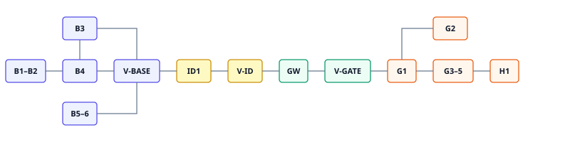

# Irisa 实施计划

## 1. 计划说明

本文把 [基座技术方案](../base-tech-design.md) 拆成可执行的里程碑和开发任务。一级结构描述方向、依赖与退出条件；二级任务控制在可独立开发和验收的范围，**不继续拆到提交或文件级**。

覆盖：

- Spring Boot 模块化单体、网关、基座、七款游戏插件。
- MySQL、Redis、ES、RocketMQ LiteTopic、模型供应商。
- JWT、领域事件 `event_log` + 补偿扫描、SSE、基座 `LlmClient`。
- 安全、观测、测试和发布验收。

不包含：独立网关集群、多活 SSE 路由、Kafka、未开开关的真实仓破产写、对战排行。

## 2. 估算口径

每个任务使用乐观／常规／悲观三点估算，单位为单人日。

- **乐观**：中间件行为符合预期，无需求返工。
- **常规**：实现、测试、评审和一次合理修正。
- **悲观**：供应商兼容、边界修正，不含需求重做。

里程碑人日是下属任务之和，不等于自然日。默认已有 MySQL、Redis、ES、RocketMQ 与模型账号；采购等待不计入。

## 3. 总体实施策略

「基础横向铺设、业务闭环纵向交付、最后硬化」。不设开发前纯验证阶段；外部能力在对应任务中接入并用契约测试收敛。

可并行：M3 与 M2 在 M1 后并行；M6 在 M5 后，不阻塞 M7；M8/M9/M10 在 M5 后可并行，M11 依赖 M8。

## 4. 里程碑总览

| 里程碑 | 目标 | 乐观 | 常规 | 悲观 | 主要前置 |
| --- | ---: | ---: | ---: | ---: | --- |
| M1 | 工程与模块基线 | 3 | 5 | 8 | 无 |
| M2 | 登录、画像、宫格 | 3 | 5 | 8 | M1 |
| M3 | Agent 端口与 Script | 3 | 5 | 8 | M1 |
| M4 | 病理 admit 与改分 | 4 | 7 | 11 | M2、M3 |
| M5 | LiteTopic、网关 SSE、法庭 | 5 | 8 | 13 | M3、M4 |
| M6 | 真模型适配器 | 2 | 4 | 6 | M5 |
| M7 | GitHub OAuth | 2 | 3 | 5 | M2 |
| M8 | 闹鬼与银行可玩一局 | 4 | 7 | 11 | M5 |
| M9 | 回音完整玩法 | 2 | 4 | 6 | M4、M5 |
| M10 | 重力与偏振可玩一局 | 3 | 5 | 8 | M5 |
| M11 | Webhook 真增量 | 1 | 2 | 4 | M8 |
| M12 | 硬化与发布验收 | 3 | 5 | 8 | M10、M11 |
| **合计** | | **35** | **60** | **96** | |

常规 **60 人日** 作规划基线，另留 15% 风险预留约 **9 人日**，不预先摊到任务。

## 5. M1：工程骨架与数据基线

### 5.1 目标与边界

建立后端工作区、Modulith 边界、Flyway 空基线与 CI。不实现游戏。

### 5.2 开发任务

| ID | 开发任务 | 交付物与验收标准 | 前置 | 乐观／常规／悲观 |
| --- | --- | --- | --- | ---: |
| M1-T1 | 创建工程 | `irisa-spi` + `irisa-app` 可构建；`.env.example`；本地启动说明 | 无 | 1／2／3 |
| M1-T2 | 固化模块边界 | 建立 gateway、auth、player、persona、ledger、event、agent、plugin、game.* 包；`ApplicationModules.verify()` 能阻止游戏互依和游戏依赖实现类 | M1-T1 | 1／2／3 |
| M1-T3 | 配置与密钥门禁 | properties 仅 `${IRISA_*}`；JWT secret&lt;32 拒启；连不上 MySQL 拒启 | M1-T1 | 0.5／1／2 |

### 5.3 退出条件

- CI 或本地 `mvn test` 含模块校验通过。
- 无 session 表、无 yaml 明文密钥。

## 6. M2：身份与进站

### 6.1 目标与边界

玩家能 mock 登录、读自己、看七格宫格。不实现游戏动作。

### 6.2 开发任务

| ID | 开发任务 | 交付物与验收标准 | 前置 | 乐观／常规／悲观 |
| --- | --- | --- | --- | ---: |
| M2-T1 | player 与 persona 存储 | DDL `player`/`persona`；建号默认 800/80/0/`[]` | M1 | 1／1.5／2 |
| M2-T2 | JWT 登录登出 | mock 201 token；me；logout 写 Redis 黑名单，失败不得假装成功；401 信封 | M2-T1 | 1／2／3 |
| M2-T3 | 画像、宫格与用量入口 | GET persona；GET games 7 格；GET /me/usage 可先返回空聚合；Agent 打点预留 | M2-T2 | 0.5／1／2 |
| M2-T4 | 身份测试 | 覆盖无头 401、同 login、logout、CORS 头 | M2-T2、M2-T3 | 0.5／0.5／1 |

### 6.3 退出条件

- 合同鉴权/画像/宫格可用真实 API 走通。
- 无 Cookie、无 session 表。

## 7. M3：Agent 基座

### 7.1 目标与边界

只负责模型交互控制。不管理 Persona、不持有 SSE 连接。

### 7.2 开发任务

| ID | 开发任务 | 交付物与验收标准 | 前置 | 乐观／常规／悲观 |
| --- | --- | --- | --- | ---: |
| M3-T1 | 自有模型端口 | `LlmClient`、预算、TonePolicy；每次调用写 agent_usage + 打点（大盘不做页） | M1-T2 | 1／2／3 |
| M3-T2 | Script 适配器 | 按 role 读 classpath 剧本；可同步或按行产出 | M3-T1 | 1／1.5／2 |
| M3-T3 | FactTool 网关 | 按名调用查询；未注册返回 empty/error JSON 不抛出进程 | M3-T1 | 0.5／1／2 |
| M3-T4 | 基座契约测试 | 非法工具立刻失败；超时映射 BUDGET_EXHAUSTED | M3-T1 至 M3-T3 | 0.5／0.5／1 |

### 7.3 退出条件

- 只有 agent 模块依赖模型相关实现。
- 无外网时 Script 可支撑后续游戏联调。

## 8. M4：病理闭环

### 8.1 目标与边界

插件转发、账本、领域事件、admit、改分、ES 长文一次打通。这是第一条完整业务路径。

### 8.2 开发任务

| ID | 开发任务 | 交付物与验收标准 | 前置 | 乐观／常规／悲观 |
| --- | --- | --- | --- | ---: |
| M4-T1 | SPI 与插件扫描 | GamePlugin.handle；未知 slug 404；游戏无 RestController；宫格 pathology ACTIVE | M1-T2、M2-T3 | 1／1.5／2 |
| M4-T2 | 账本与领域事件 | ledger 幂等、event 白名单、补偿扫 PENDING、apply_status 条件更新、健康度下限 | M2-T1 | 1.5／2.5／4 |
| M4-T3 | 病理 admit | 游戏表随本里程碑 Flyway；事务内写 MySQL+event；ES 由事件增量异构 | M3、M4-T1、M4-T2 | 1／2／3 |
| M4-T4 | 病理集成测试 | 缺字段 400、扣血、ES、日志无全文、二次 admit 再扣 | M4-T3 | 0.5／1／2 |

### 8.3 退出条件

- admit 后画像变化且账本、事件、ES 一致。
- 插件不能直接改 persona（代码与测试可证明）。

## 9. M5：法庭与 SSE

### 9.1 目标与边界

网关持连接，基座只 send LiteTopic。开庭、质询、签字、审计员引用病历。

### 9.2 开发任务

| ID | 开发任务 | 交付物与验收标准 | 前置 | 乐观／常规／悲观 |
| --- | --- | --- | --- | ---: |
| M5-T1 | SseSink 与 LiteTopic | send `irisa-sse-{playerId}-{topic}`；游戏包无 RocketMQ 依赖 | M1、RocketMQ 环境 | 1／2／3 |
| M5-T2 | 网关 SSE | `/stream` 鉴权、归属校验、SseEmitter、订阅、本地 ping、断连退订 | M5-T1、M2-T2 | 1.5／2.5／4 |
| M5-T3 | 法庭玩法 | 立案、异步剧本、FactTool exhibit、签字 VERDICT、事件 court.verdict.signed | M4、M3、M5-T2 | 1.5／2.5／4 |
| M5-T4 | 法庭与通道测试 | 事件名、有/无病历、签字、插件崩溃隔离、MQ 挂时短请求仍可用 | M5-T3 | 1／1／2 |

### 9.3 退出条件

- 技术方案文末基座闭环验收通过。
- ping 不进入 LiteTopic。
- Redis 无 SSE 通道键。

## 10. M6：真模型适配器

### 10.1 目标与边界

同一 `LlmClient` 增加 OpenAI 兼容实现。游戏代码零改动。

### 10.2 开发任务

| ID | 开发任务 | 交付物与验收标准 | 前置 | 乐观／常规／悲观 |
| --- | --- | --- | --- | ---: |
| M6-T1 | OpenAI 兼容适配 | 流式仍 send LiteTopic；预算与失败映射；密钥仅环境变量 | M3、M5 | 1.5／3／4 |
| M6-T2 | 双 provider 回归 | script 下 M5 测试全绿；无 key 时 openai 失败不静默回 Script | M6-T1 | 0.5／1／2 |

### 10.3 退出条件

- 配置切换即可；游戏模块无模型 SDK。

## 11. M7：GitHub OAuth

### 11.1 开发任务

| ID | 开发任务 | 交付物与验收标准 | 前置 | 乐观／常规／悲观 |
| --- | --- | --- | --- | ---: |
| M7-T1 | OAuth 换自家 JWT | `/api/auth/github`；复用建号；`/me` 不变；关 mock 则 mock 404；scope 默认无 repo | M2 | 2／3／5 |

### 11.2 退出条件

- 真号或 mock IdP 走通；同 login 不新建号。

## 12. M8：代码事实（闹鬼 + 银行）

### 12.1 目标与边界

一条产品故事：脏 diff 变成幽灵和负债。不靠 webhook 也能玩。JavaParser 不在本里程碑必交。

### 12.2 开发任务

| ID | 开发任务 | 交付物与验收标准 | 前置 | 乐观／常规／悲观 |
| --- | --- | --- | --- | ---: |
| M8-T1 | 闹鬼手动 ingest | 启发式分类、稳定坐标、事件扣信用、幂等 | M4-T1、M4-T2 | 2／3.5／5 |
| M8-T2 | 银行 scan 与 FactTool | 头寸、K 线、dry-run 破产、FACT_BANK_POSITION、同 path 加息 | M8-T1、M5 | 1.5／2.5／4 |
| M8-T3 | 代码事实测试 | TODO→WRAITH、不连扣、开庭能读头寸、无真实 PR | M8-T1、M8-T2 | 0.5／1／2 |

### 12.3 退出条件

- 无 GitHub 仍可玩一局；法庭审计员能读负债或 empty。

## 13. M9：回音

### 13.1 开发任务

| ID | 开发任务 | 交付物与验收标准 | 前置 | 乐观／常规／悲观 |
| --- | --- | --- | --- | ---: |
| M9-T1 | 立誓与隐形 | swear 写 ES+oath；state 无原文 | M4、M5 | 1／1.5／2 |
| M9-T2 | Cron 武装与打断 | 无病历不触发；SEVERE 窗口武装；pending 无全文；关键词解锁 | M9-T1 | 1／2／3 |
| M9-T3 | 回音测试 | 从不 admit 则永不 pending；错词 400 | M9-T2 | 0.5／0.5／1 |

### 13.2 退出条件

- 连续摆烂可被黑屏拷问；正常使用不被误伤。

## 14. M10：重力与偏振

### 14.1 开发任务

| ID | 开发任务 | 交付物与验收标准 | 前置 | 乐观／常规／悲观 |
| --- | --- | --- | --- | ---: |
| M10-T1 | 重力 ingest | Agent 强制 JSON；energyNet 覆盖画像；state 无聊天原文 | M3、M4-T2 | 1.5／2.5／4 |
| M10-T2 | 偏振对局 | challenge/rebut/close；SSE punch；bias_tags；最多 5 回合 | M5 | 1.5／2／3 |
| M10-T3 | 测试 | energyNet 一致；punch 不是 message；宫格七格 ACTIVE | M10-T1、M10-T2 | 0.5／0.5／1 |

### 14.2 退出条件

- 七款均能无 webhook 玩一局。

## 15. M11：Webhook

### 15.1 开发任务

| ID | 开发任务 | 交付物与验收标准 | 前置 | 乐观／常规／悲观 |
| --- | --- | --- | --- | ---: |
| M11-T1 | 验签与去重分发 | HMAC、deliveryId NX 24h、分发 haunt/bank；手动通道保留 | M8、M7 更佳 | 1／2／4 |

### 15.2 退出条件

- 假重放不重复生成幽灵；坏签名不入库。

## 16. M12：硬化与发布验收

### 16.1 开发任务

| ID | 开发任务 | 交付物与验收标准 | 前置 | 乐观／常规／悲观 |
| --- | --- | --- | --- | ---: |
| M12-T1 | 端到端主路径 | 登录、admit、开庭、签字、七款各一局 | M5、M8–M10 | 1／2／3 |
| M12-T2 | 安全与隔离 | 越权、日志脱敏、插件崩溃、密钥不进库 | M2、M4 | 1／1.5／2 |
| M12-T3 | 观测与镜像 | 5xx、补偿失败、sse 连接、Dockerfile 不含中间件、README | M5 | 0.5／1／2 |
| M12-T4 | 发布评审 | 阻断缺陷关闭；live-writes false | M12-T1 至 T3 | 0.5／0.5／1 |

加深（JavaParser、收藏夹、破产实打、回音近邻）不进 M12 必交，单项另开变更。

### 16.2 退出条件

- 技术方案检查清单通过。
- 无未处理的数据隔离或恢复阻断。

## 17. 纵向交付检查点

里程碑按依赖组织；研发过程必须用检查点验证真实闭环。

| 检查点 | 可演示范围 | 必须完成 |
| --- | --- | --- |
| V1 进站 | mock 登录，看见自己和宫格 | M2 |
| V2 病理 | admit 出病历，健康度下降 | M4 |
| V3 法庭 | 开庭 SSE，审计员引用病历，签字 | M5 |
| V4 真模型 | 切 provider 后主路径仍成立 | M6 |
| V5 七款可玩 | 无 webhook 七局都能走完 | M8–M10 |
| V6 发布候选 | webhook、安全、镜像、回归 | M11、M12 |

## 18. 需求与任务追踪

| 需求 | 主要任务 | 最终验收 |
| --- | --- | --- |
| JWT 进站 | M2 | V1 |
| 账本与领域事件 | M4-T2 | 改分幂等测试 |
| 病理 | M4 | V2 |
| Agent 与 Script | M3 | V2/V3 |
| SSE / LiteTopic | M5-T1、M5-T2 | V3 |
| 法庭 | M5-T3 | V3 |
| 真模型 | M6 | V4 |
| OAuth | M7 | 真号登录 |
| 闹鬼银行 | M8 | V5 |
| 回音 | M9 | V5 |
| 重力偏振 | M10 | V5 |
| Webhook | M11 | V6 |

## 19. 计划控制规则

### 19.1 开工

- 任务完成状态要求前置达到退出条件。
- 前端可在合同冻结后用 fixture 并行；里程碑退出必须走真实链路。
- 供应商行为与方案不一致时，在该任务内更新适配，只有架构级冲突才暂停。

### 19.2 完成定义

- 功能通过评审。
- 任务要求的测试通过。
- 数据隔离与日志符合技术方案。
- 对外契约变化时先改 `docs/contracts/`。

### 19.3 变更控制

出现以下情况必须改本计划：新增游戏、改网关/基座边界、改用 Redis 推 SSE、改为多活 SSE、游戏直接接模型 SDK。

## 20. 发布门禁

- [ ] M1 至 M12 退出条件满足
- [ ] V1 至 V6 通过
- [ ] 无密钥进 git
- [ ] 单活 SSE 约束写入 README
- [ ] live-writes 默认 false
